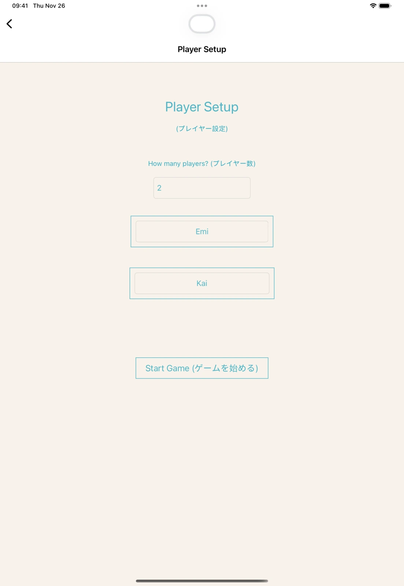
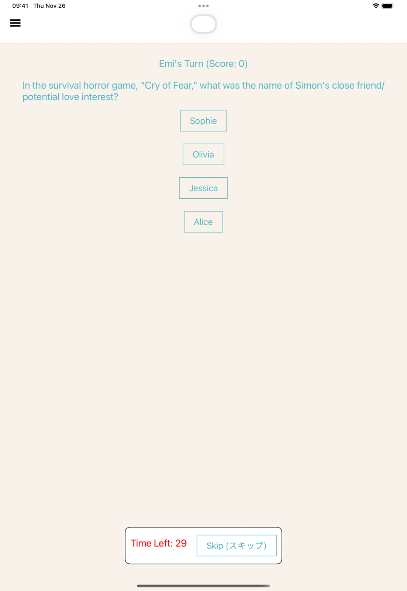
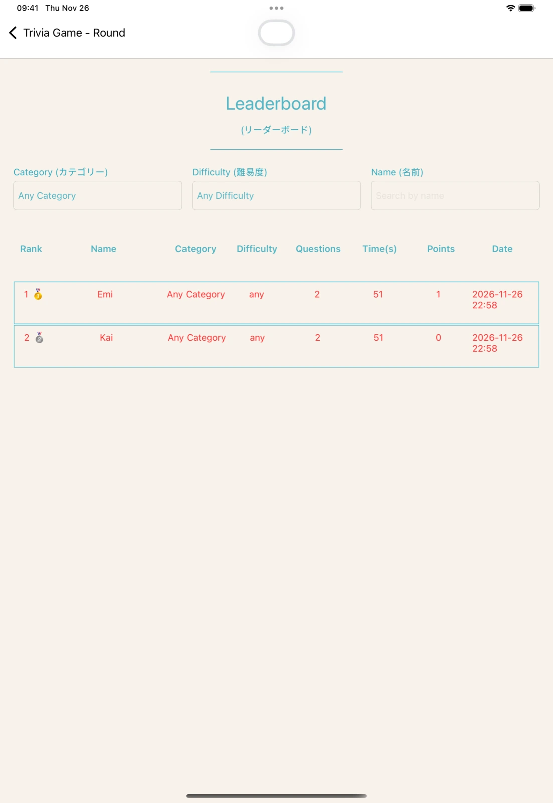

# Trivia Game (トリビアゲーム)

I started this trivia game in 2023. One to four players share a device and take turns racing the clock. I built the interface in C# and XAML with .NET MAUI, pairing English and Japanese labels in a light theme. The Git history for the original implementation runs from December 2024 to January 2025.

## Demo

[Watch a two-player round (MP4)](docs/demo/walkthrough.mp4) · [Browse every captured state](docs/demo/README.md)

| Set up the players | Beat the clock | Compare scores |
| :---: | :---: | :---: |
| [](docs/demo/05-players.webp) | [](docs/demo/06-question.webp) | [](docs/demo/13-leaderboard.webp) |

Captured in Light mode on an iPad Pro simulator. The game no longer follows the device's appearance: Light is the default, and Dark is an explicit choice in **Settings**.

## Play a round

1. Open **Settings** to choose a category, difficulty, question type (multiple choice or true/false), and number of questions per player. The default is 10 questions per player with no filters.
2. Choose **New Game**, select the number of players, and enter their names. An internet connection is needed to load the questions.
3. Each player finishes their questions before passing the device. Answer within 30 seconds or choose **Skip**. Correct answers earn 1 point on easy, 2 on medium, and 3 on hard.
4. Dismiss **Game Over!** to see the local leaderboard. Search by player name or filter by category and difficulty to compare scores across rounds.

For a short first game, try two players and two questions each. Keep the total (players × questions per player) at 50 or fewer, the [Open Trivia DB request limit](https://opentdb.com/api_config.php). If a round ends without questions, check the connection and try a broader category or difficulty.

## How it works

[`TriviaService`](TriviaGameApp/Services/TriviaService.cs) requests the whole group's questions in one call and decodes HTML entities in the text. [`GamePage`](TriviaGameApp/Views/GamePage.xaml.cs) divides the questions among players and handles the timer and scoring. The app stores scores in `leaderboard.json` and settings in `trivia_settings.json` in the app data directory. Settings also use MAUI Preferences as a fallback.

## Run locally

Use the .NET 8 SDK, the MAUI workload for your target, and its platform toolchain. For example, to run the Mac Catalyst target on a Mac with compatible Xcode installed, start in the repository root:

```sh
dotnet workload install maui-maccatalyst
dotnet build TriviaGameApp/TriviaGameApp.csproj -t:Run -f net8.0-maccatalyst -p:TargetFrameworks=net8.0-maccatalyst
```

The [project file](TriviaGameApp/TriviaGameApp.csproj) also declares `net8.0-android`, `net8.0-ios`, and, on Windows, `net8.0-windows10.0.19041.0`.

<details>
<summary>Run on an iPad simulator (Apple silicon)</summary>

Install an iPad simulator runtime in Xcode. List the available devices, copy an iPad's UDID, then run:

```sh
dotnet workload install maui-ios
xcrun simctl list devices available
```

```sh
UDID="your-ipad-simulator-udid"
dotnet build TriviaGameApp/TriviaGameApp.csproj -t:Run -f net8.0-ios \
  -p:TargetFrameworks=net8.0-ios -p:RuntimeIdentifier=iossimulator-arm64 \
  -p:_DeviceName=":v2:udid=$UDID"
```

The demo was built with .NET SDK 8.0.428 and played on an 11-inch iPad Pro (M4) simulator running iOS 18.5. No API key or account is needed.

</details>

## Credits and license

Questions and answers come from the [Open Trivia Database](https://opentdb.com/) under [CC BY-SA 4.0](https://creativecommons.org/licenses/by-sa/4.0/). The application code is distributed under the [MIT License](LICENSE.txt).
